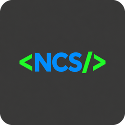

# NCS — Node Container System

NCS is a proprietary, node-based programming language designed around structured data containers, stack-based execution, compilation, and interpretation. Its goal is to provide efficient execution, readable syntax, and detailed debugging tools for software development.

## Features and Design Goals

- Named nodes with typed signatures.
- Compiled and interpreted execution models.
- Stack-based data and memory management.
- Detailed compiler and runtime logging.
- Native shared-library compilation, with cross-platform support as a development goal.
- A long-term goal of self-hosted compilation.

## Development Status

NCS is under active development. Its initial compiler is built in Rust, with the goal of transitioning to a compiler written in NCS itself.

## Usage and Licensing

You may use NCS to develop independent programs, games, tools, libraries, and modules in accordance with its license. NCS itself, including its protected compiler, interpreter, logger, and runtime, is proprietary and subject to redistribution and modification restrictions.

- [About NCS](ABOUT.md)
- [NCS Proprietary Software License](LICENSE.md)

Copyright (c) 2026 Phoenixwolf1245.
